# craft-more skills

**`craft-more`** is a collection of skills for a pleasant co-working experience with AI, in which you keep full control.

The skills fit pair-programming between people and coding agents, and they work with other [harnesses](https://en.wikipedia.org/wiki/Agent_harness) too.
They are orthogonal and composable — use the whole set, or try a single skill on its own.

The core skills bring thorough planning, interaction without needless waiting, and confidence annotations that keep the data an LLM works with validated.

The learning-loop skills let an agent learn from its own mistakes: past sessions are evaluated, documented in a structured format, and turned into rules for the future.
Skill-authoring grows those suggestions into skills of your own.

A full list of available skills and their maturity can be found in the [**`SKILLs Catalog`**](docs/CATALOG.md).

[**Why craft-more**](docs/WHY.md){ .md-button }
[**SKILLs Catalog**](docs/CATALOG.md){ .md-button }
[**Getting started**](docs/GETTING_STARTED.md){ .md-button }
