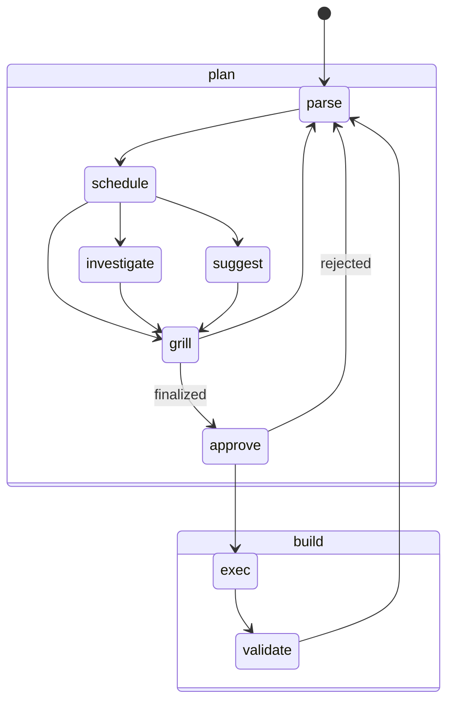

# plan-build-workflow

One unit of work, done in the open: plan and grill it first, then build in small approved steps — nothing written without a go.

This is a standalone skill from the [craft-more](<../../README.md>) skill collection. Install and usage: [Getting started](../../docs/GETTING_STARTED.md) · [Install](../../docs/INSTALL.md)

## Goal

A unit of work runs in a fixed, reviewable order: the goal is sharpened by grilling before anything is written, each build step is approved, and the user stays in control of every step. Planning and building stay separate, so misunderstandings surface early and cheap.

## Strategy (mock)

The eight states are `parse`, `schedule`, `grill`, `investigate`, `suggest`, `approve`, `exec`, `validate`; `plan` and `build` are **phase groupings**, not states.

The design rationale behind this machine — its nine principles and their trade-offs — is in [Design principles](./DESIGN.md).

### Phases

1. **Plan** — a grilling session (default): state the goal and its abort condition, then sharpen the plan by interview before anything is written.
2. **Build** — execute the agreed plan: one step per answer, every write announced in advance.
3. **Verify and hand back** — verify before claiming done, then the user stages and commits.

After every build, the next planning phase begins immediately — a fresh grilling for the next unit of work. We do not stay in build.

### Planning = grilling (default)

The plan is a design tree: every decision branches into the decisions that hang off it. Work it in rounds.

- the frontier is every decision whose prerequisites are already settled — the questions askable now without guessing at answers not yet heard
- ask the whole frontier per round; each round reshapes the tree and recomputes the next frontier
- a question that depends on another still open in this round belongs to a later round

Each question is numbered and carries a recommended answer, in the shape `❓ [DECIDE] Qn — <title>: <body>` followed by `➡️ <recommended answer>`, questions separated by a horizontal rule.

- group related questions under one theme, and give each question its context up front — the problem it solves and the change proposed; answerability beats completeness
- word each question so "yes" accepts the recommended answer
- decisions belong to the user: put each to them and wait — never decide alone
- the plan is done when the frontier is empty: every branch visited, nothing left silently assumed

Default: show the whole frontier, ask one focused question concretely. On an explicit "grill-me" trigger, put the whole frontier per round with the harness's questioning tool. Render the frontier as a 🧲 `[STEER]` node in the [parse-back](../parse-back/README.md): its ❓ `[DECIDE]` subnodes are the questions, grouped by topic, each short yet readable on its own — never prose in the node; longer context goes below.

The gate from Plan to Build is an explicit confirmation of shared understanding — a stated goal is not a go.

### Only the commissioned work

Do only what was explicitly asked — no extra interpretations. When it is unclear what comes next, ask directly.

### Approval flow

- approval before write: a stated goal is not a write-Go — ask when in doubt
- approval asks list every file to be written with its line counts (see the count rule below)
- counts are measured, never hand-tallied: a prepared count comes from applying the diff in a scratch worktree under `./.tmp/` and quoting `git apply --numstat`; a live count is quoted from `git diff --numstat` after the write; a pre-write forecast is an estimate only — the measured count wins and any divergence is reported
- no `[APPROVE]`, no write: every write is carried by an open 🔐 `[APPROVE]` node in the parse-back — with none open, the write does not happen; the marker is the gate, not a label
- a write-Go is not a content-Go: content choices (names, translations, wording) are proposed first
- stage and commit are the user's tasks — never attempt or suggest them, except when the user explicitly commands it

### Handoff

This skill owns the phase details for one unit of work. The meta-workflow [workflow](../workflow/README.md) sequences units across a session (backlog instead of batch, night shift as an approved exception) and hands off here — both stay aware of the same phase sequence.
